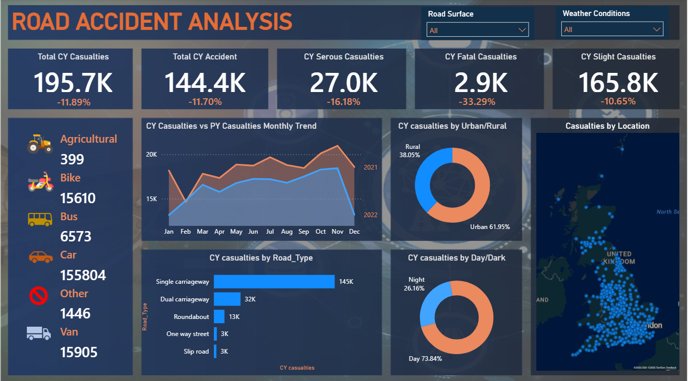

# 🚦 Road Accident Analysis | Power BI Dashboard

An interactive Power BI dashboard that analyzes UK road accident casualties, comparing the **current year (CY)** against the **previous year (PY)** to uncover where, when, and how accidents happen.



## 📌 Project Overview

Road safety teams need a quick way to see whether casualties are rising or falling and which conditions are the riskiest. This dashboard consolidates accident records into a single view with year-over-year comparison and dynamic filters.

## 🎯 Objectives

- Track total casualties and accidents versus the previous year.
- Break down casualties by severity: **Fatal, Serious, and Slight**.
- Identify the vehicle types, road types, and conditions linked to the most casualties.
- Visualize the geographic spread of accidents across the UK.

## 📊 Key KPIs

| KPI | Current Year | vs. Previous Year |
|---|---|---|
| Total Casualties | 195.7K | -11.89% |
| Total Accidents | 144.4K | -11.70% |
| Serious Casualties | 27.0K | -16.18% |
| Fatal Casualties | 2.9K | -33.29% |
| Slight Casualties | 165.8K | -10.65% |

## 🔍 Key Insights

- **Casualties declined across every severity level**, with the largest drop in fatal casualties (-33.29%).
- **Cars account for the most casualties** by far (155,804), followed by vans (15,905) and bikes (15,610).
- **Urban areas make up ~62%** of casualties, versus ~38% in rural areas.
- **Around 74% of casualties happen in daylight**, and 26% at night.
- **Single carriageways are the most dangerous road type** (145K casualties), well ahead of dual carriageways (32K) and roundabouts (13K).
- The monthly trend shows the current year running below the previous year for most of the months, with casualties peaking in the autumn months (Oct-Nov).

## 🖼️ Dashboard Components

- KPI cards with year-over-year % change
- Casualties by vehicle type (Agricultural, Bike, Bus, Car, Other, Van)
- CY vs PY monthly trend (area chart)
- Casualties by Urban/Rural (donut)
- Casualties by Day/Dark (donut)
- Casualties by Road Type (bar chart)
- Casualties by Location (map)
- **Slicers:** Road Surface, Weather Conditions

## 🛠️ Tech Stack

- **Microsoft Excel** - data inspection and cleaning
- **Power BI Desktop** - data modeling and visualization
- **Power Query** - data transformation
- **DAX** - measures for CY/PY comparison and % change

## 📂 Data Source

Dataset from [Kaggle](https://www.kaggle.com/) - UK road accident data. *(Add the exact dataset link here.)*

## 📁 Repository Structure

```
road-accident-analysis/
├── Dashboard_Photo/
│   └── dashboard.png     # Dashboard screenshot
├── Road_Accident.pbix    # Power BI report
└── README.md
```

## ▶️ How to Open

1. Download the `.pbix` file from this repository.
2. Open it with the free [Power BI Desktop](https://powerbi.microsoft.com/desktop/).
3. Use the **Road Surface** and **Weather Conditions** slicers to explore the data.
